# DeepSeek Harness 桌面版 安装与使用教程（macOS）

按顺序做一遍就行，每一步都写清楚了该点哪里。

- **适用系统**：macOS 12 或更高（Apple 芯片 / Intel）
- **软件版本**：0.2.1-rc.3
- **全程耗时**：约 15 分钟
- **文档更新**：2026-10-29
- **用 Windows？** 看 [Windows 版教程](DeepSeek-Harness-教程.md)，或者打开 [网页版](index.html)（在页面左侧可以一键切换 Windows / macOS）

> 图片都在 `img/` 文件夹里。Mac 专属的图在 `img/mac/`，正文里标「Mac 截图 N」；标「截图 NN」的是客户端界面图，Mac 上长得一样，直接复用 Windows 的图。（**例外**：截图 18 里写着 `D:\work\Test1\…` 这种 Windows 路径，Mac 版换成了「Mac 截图 4」。）

## 目录

- 0 · 先搞清楚四件事
- 1 · 安装前的准备
- 2 · 下载
- 3 · 安装
- 4 · 注册账户（4.1 手机号登录 / 4.2 API Key / 4.3 稍后配置 / 4.4 设置引导）
- 5 · 充值（5.1 在客户端里 / 5.2 在网页里 / 花费与用量）
- 6 · 第一次使用
- 7 · 日常使用要注意的
- 8 · 卸载（8.1 正确顺序 / 8.2 彻底清干净 / 8.3 命令行版）
- 9 · 常见问题
- 10 · 一页速查

---

## 0 · 先搞清楚四件事

### ① 它是干什么的

DeepSeek Harness 是 DeepSeek 官方出的电脑客户端。它不只是聊天，还能读你电脑上的文件、整理资料、改代码、执行命令——是一个“能动手干活”的助手。

### ② 三个词的关系，打个比方就懂

**Agent 是机床，模型是师傅，Token 是工资。**

- **机床 = Agent**，就是你要装的这个客户端。它提供工具并真正动手：读文件、写文件、跑命令、装环境。它自己不聪明，离开师傅就是一堆铁。
- **师傅 = 模型**，DeepSeek 的大模型。它负责动脑子：听懂你的话、决定下一步干什么、把代码写出来。它在云端跑，不在你这台 Mac 里。
- **工资 = Token**。模型每读一个字、每写一个字都算 Token，按量计费。工资（账户余额）决定你能请谁（用哪个模型）、能干多少活（能聊多少轮）。

机床越好，能干的活越杂；师傅越强，活干得越漂亮；工资决定这两样你能用多久。**所以你只需要装机床、给工资卡充钱——师傅在云上，不用装，也装不了。**

### ③ 它要花钱，不是免费的

平常在手机 App 或网页里跟 DeepSeek 聊天是免费的，但 Harness 走的是“API 按量计费”：用多少算多少，从账户余额里扣。**余额为 0 时不能用，必须先充值。**（新用户有时送几元赠金，有没有、多久过期，以页面显示为准。）

### ④ 只从官网下载

官方入口只有这两个，别的地方下的都可能是改装版：

- <https://www.deepseek.com/download/>
- <https://www.deepseek.com/harness/>

网盘、软件下载站、所谓“破解版 / 汉化版”，常被塞广告甚至木马，别用。**Mac 上尤其别用“别人编译好的 dmg / zip”**，系统拦不住里面的脚本。

> **太长不看版**
> 官网下载 dmg → 把图标拖进「应用程序」→ 第一次打开点“仍要打开” → 打开后点「登录」→ 手机号注册 → 点左下角账号 → **设置 → 账号与余额 → 充值** 充 10 元 → 回客户端选个文件夹 → 发一句话试试。

<details>
<summary>想多认几个名字？（不看也不影响往下做）</summary>

**叫 Agent 的（机床）**：DeepSeek Harness、Pi、Claude Code、Cursor、GitHub Copilot、Codex CLI、Windsurf、Cline、Roo Code、OpenHands；国内的还有通义灵码、Trae、CodeBuddy、Qoder……

**叫模型的（师傅）**：DeepSeek、GPT、Claude、Gemini、Grok；国内的 Qwen（通义千问）、Kimi、GLM（智谱）、豆包……

型号名字几个月换一批，记住这些“家族名”就够了。真想知道谁强，别信排行榜，拿你自己的活让它们各干一遍最准。

还有一点容易混：上面那些 Agent 里，很多是编辑器 / IDE 插件（Cursor、Copilot 这类），DeepSeek Harness 是单独的桌面程序——不写代码也能用。

</details>

---

## 1 · 安装前的准备

1. 确认版本和芯片：点屏幕左上角的**苹果菜单 → 关于本机**。看「芯片」那一行——写 **Apple M…** 就是 Apple 芯片（arm64），写 **Intel Core…** 就是 Intel 芯片（x64）；顺便确认 macOS 是 12 或更高。
2. 腾出大约 2 GB 硬盘空间。
3. 电脑连着网。
4. 手机放手边——注册要收短信验证码，或者用微信扫码。

> **为什么要先看芯片？**
> Mac 现在有两代芯片，安装包是分开的。选错了不是装不上，就是打开时提示“不支持这台 Mac”，白下一遍 300 MB。

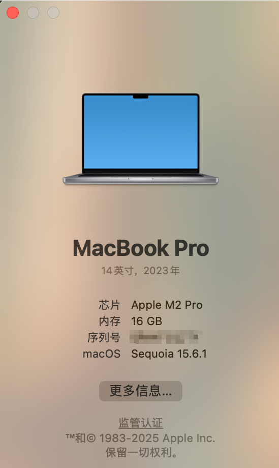

---

## 2 · 下载

1. 打开浏览器（Safari、Chrome、Edge 都行），地址栏输入 `www.deepseek.com/download/` 回车。
2. 往下找 **DeepSeek Harness** 那一块，点 **下载适用于 macOS 版本**（按钮上会写 macOS / Apple 芯片）。
3. 官网如果给了两个 Mac 包，按第 1 步查到的芯片选：**Apple 芯片**选 arm64 / Apple Silicon，**Intel** 选 x64 / Intel。
4. 浏览器开始下载一个 `.dmg` 文件，名字类似 `deepseek-harness-0.2.1-rc.3-mac-arm64.dmg`，大约 300 MB。
5. 找文件：Safari 点右上角下载按钮（↓ 箭头），Chrome 按 `⌘ + ⇧ + J`；文件都在「下载」文件夹里。只想看文件本身：在访达里按 `⌥ + ⌘ + L` 直接打开「下载」。

> **文件名里有 rc 是正常的**
> 表示“预览版”，功能正常，只是还在持续改进，会自动升级。

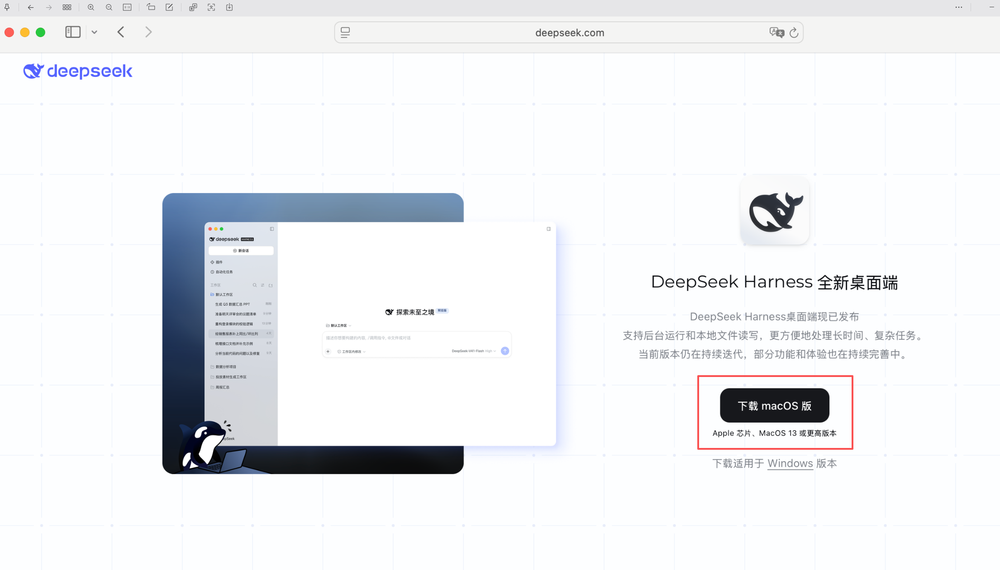

---

## 3 · 安装

1. **双击**下载好的 `.dmg` 文件，会弹出一个窗口，里面是 DeepSeek Harness 图标和「应用程序」文件夹的快捷方式。
2. 把 DeepSeek Harness 图标**拖进「应用程序」文件夹**，等几秒复制完。然后把左边 dmg 名字后面的 ⏏ 点一下（弹出），免得它一直挂在桌面上。
3. 打开「访达 → 应用程序」，**双击 DeepSeek Harness** 启动。第一次启动慢一点是正常的。
4. 第一次启动**很可能被系统拦住**：弹窗说“无法打开，因为 Apple 无法验证”。点 **好 / 完成** → 打开 **系统设置 → 隐私与安全性** → 往下滚，找到“…已被阻止使用”那一行 → 点 **仍要打开** → 输入电脑密码或按 Touch ID。**只有第一次要这么做。**（也可以在「应用程序」里按住 `Control` 点图标 → 选「打开」。）
5. 如果它问能不能访问「桌面 / 文稿 / 下载」文件夹，**按需点允许**就行；它真正干活的范围还是第 6 步你指定的工作区文件夹。
6. 启动成功后，屏幕**右上角菜单栏**会出现它的图标，Dock 里也会有一个。想以后好找：右键 Dock 图标 → **选项 → 在 Dock 中保留**。

> **⚠️ 拖不进「应用程序」，或者提示“已损坏，无法打开”？**
> ① 先确认 dmg 是从官网下的，别用网盘版本；② 打开「终端」（`⌘ + 空格` 搜“终端”回车），粘贴运行：
>
> ```bash
> xattr -dr com.apple.quarantine "/Applications/DeepSeek Harness.app"
> ```
>
> 回车，再双击打开。（会要求输开机密码，输入时屏幕不显示字符是正常的。）

> **⚠️ 点「管理 dsh 命令」弹“请先将 DeepSeek Harness 安装到「应用程序」文件夹”？**
> 这句的意思是：**当前跑着的这份程序不在 `/Applications` 里**。最常见的成因是从 dmg 窗口里，或者从「下载」文件夹里直接双击打开的——这种启动方式 macOS 会给它一个临时路径（App Translocation），程序自己都找不到自己在哪。按顺序做：
>
> 1. 按 `⌘Q` 退出程序；桌面上还挂着 dmg 的话，在访达侧边栏点它后面的 ⏏ 弹出。
> 2. 访达按 `⇧⌘A` 打开「应用程序」，确认里面有 **DeepSeek Harness**。如果它只躺在「下载」里，拖进去（问是否替换就选**替换**）。
> 3. **只从「应用程序」里双击启动**，别再点 dmg 窗口里那个图标。
> 4. 已经在「应用程序」里还报同样的错：退出应用，终端运行 `xattr -dr com.apple.quarantine "/Applications/DeepSeek Harness.app"`，再启动一次；还不行重启一次 Mac。
> 5. 检查是不是存了好几份：终端运行 `mdfind -name "DeepSeek Harness.app"`，只保留 `/Applications` 里那份，其它拖到废纸篓。

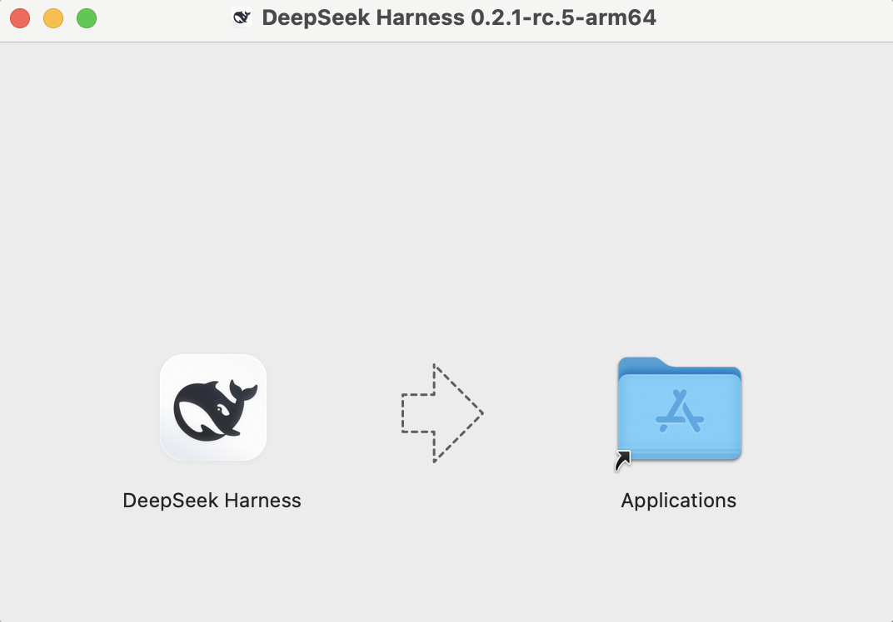

---

## 4 · 注册账户

第一次打开会出现一个**欢迎页**，上面两个入口：**登录** 和 **添加 API Key**。

> **📷 关于本节的截图**
> 下面这些是客户端界面图，取自 Windows 版。Mac 上功能完全一样，只是窗口左上角是红黄绿三个圆按钮，按钮文字、位置照着对应就行。

> **新手直接选「登录」**
> 不用管什么是 API Key，走下面 4.1 就行。4.2 是给已经会玩 API 的人看的备选。

### 4.1 主路径：手机号注册并登录（推荐）

1. 欢迎页点 **登录**。
2. 电脑会自动打开浏览器（Safari 或你的默认浏览器），进入 DeepSeek 开放平台的授权页面。
3. 没注册过就点 **注册**：
   - 输入**手机号** → 点 **获取验证码**；
   - 手机收到 4~6 位数字短信，填进去；
   - 设置密码（8 位以上，字母 + 数字）；
   - 勾选同意用户协议 → 点 **注册 / 登录**。
   - 也可以选页面上的 **微信扫码**，更省事。
4. 登录成功后浏览器会显示“授权成功 / 可以返回应用”，并可能自动跳回客户端。如果浏览器先弹一句“是否允许此网页打开 DeepSeek Harness”，点 **允许**。
5. 没自动跳回来：回到浏览器那个完成页点 **打开客户端**；或者直接切回 DeepSeek Harness 窗口。
6. 回到客户端后，会先走一遍**设置引导**（见 4.4），走完就进主界面了。**设置 → 账号与余额** 里能看到余额。

> **一个特别容易误解的地方**
> 这里的账号是 **DeepSeek 开放平台（platform.deepseek.com）** 的账号，不是你手机 App 里聊天用的那个。用同一个手机号登录，但**钱包不通用**，**手机 App 里的聊天记录也不会同步过来**——这是正常的，不是出错。

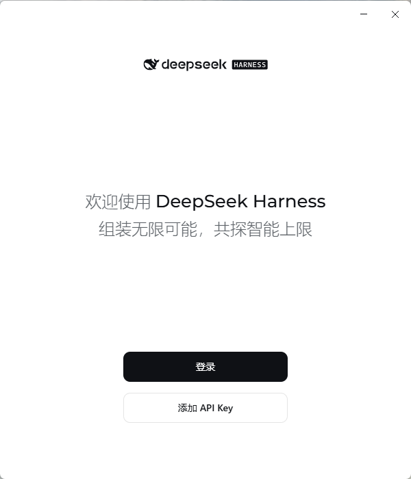

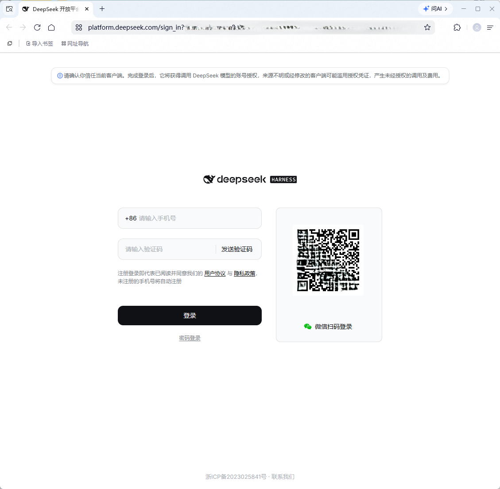

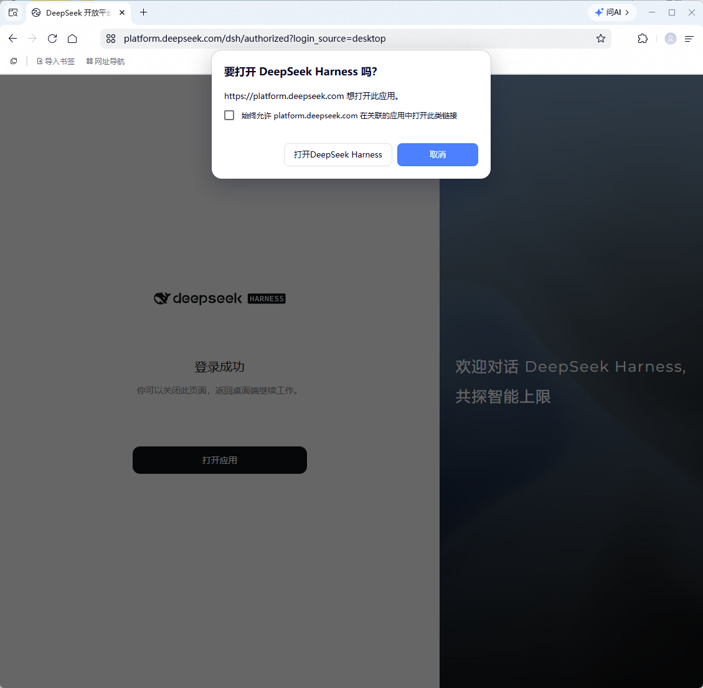

### 4.2 附注：想用 API Key 的看这里

适用情况：你已经在用 DeepSeek API，或者手上有别人给的密钥。

1. 浏览器打开 `platform.deepseek.com`，用手机号登录。
2. 左侧菜单点 **API Keys** → **创建 API Key** → 起个名（比如 `my-mac`）→ 创建。
3. 页面显示一串以 `sk-` 开头的字符。**它只显示这一次**，点“复制”立刻存到备忘录里。
4. 回到客户端欢迎页点 **添加 API Key**，粘贴进去 → **保存并继续**。

> **🚫 密钥就等于银行卡密码**
> 别发群里、别贴到网上、别让它出现在截图里。泄露了别人就能花你的钱。

### 4.3 暂时不想登录

欢迎页上有 **稍后配置**，可以先看看界面。但只要有任务要调用模型，就必须先配好账号或密钥，否则会报错。

### 4.4 第一次进客户端：跟着设置引导走一遍

授权成功、第一次进客户端时，会自动出现一个**设置引导**，一共五屏，一屏点一次 **下一步 / 继续**，走完就进主界面了。

1. 前面几屏是说明和基本设置，看着点「下一步」就行。
2. 如果某一屏让你选**工作区文件夹**，先选个空文件夹——比如在桌面上新建一个 `AI 工作区`。**别一上来就选整个个人文件夹或“文稿”**（第 6 节细讲）。
3. 有一屏上就有 **充值** 按钮（截图 10）。新账号余额是 0，**直接在这儿点进去充**，比单独去网页少走一步，详细步骤见第 5 节。
4. 有一屏需要你做一个选择（截图 11），按自己的需要选，选完点「下一步」。
5. 看到主界面（引导第 5 屏，截图 12）就说明配置完了，可以开始用。
   引导只弹这一次，以后想改设置就去 **设置** 里改，选错了不用重来。

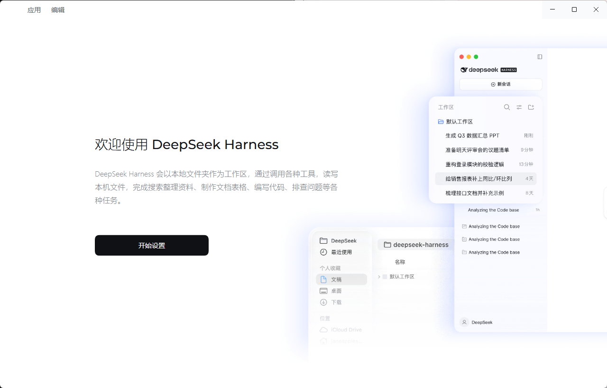

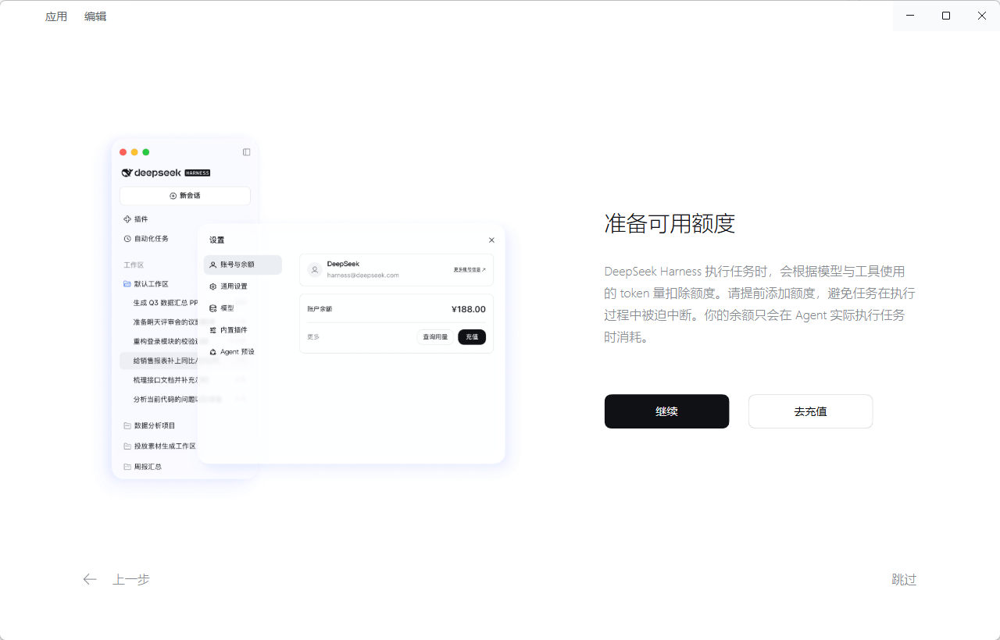

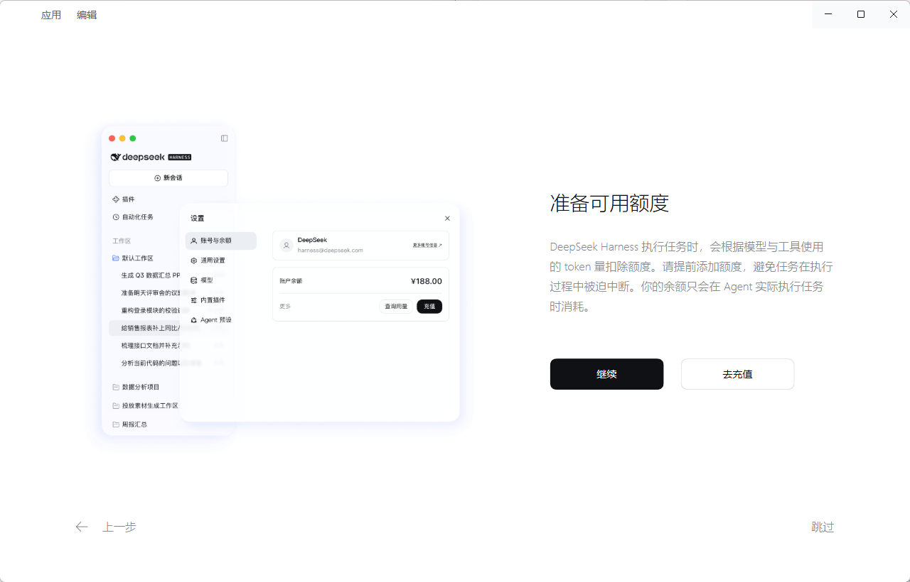

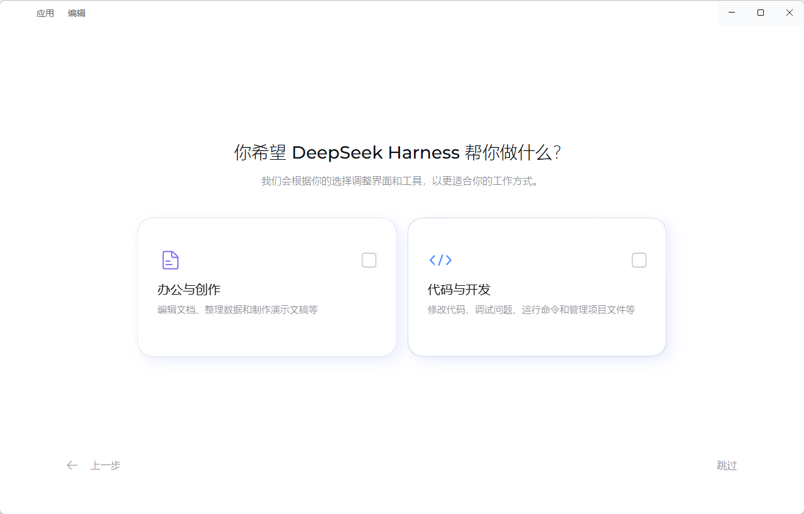

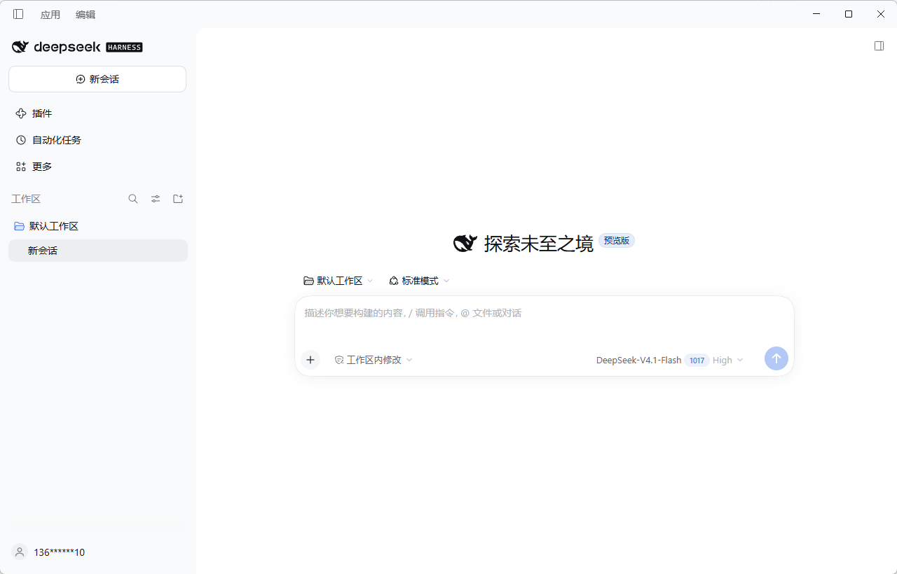

---

## 5 · 充值（关键一步）

登录后余额通常是 0，或者只有一点赠金——**这时候还干不了活，得自己充钱**。两条路效果一样：**在客户端里点**（5.1，推荐），或者**去网页充值**（5.2）。钱充进的是同一个账户，用哪个都行。

### 5.1 在客户端里充值（推荐）

1. 打开 DeepSeek Harness，点窗口**左下角**自己账号那一行（显示手机号，比如 `136******10`）。
2. 弹出**设置**窗口，左侧菜单点 **账号与余额**。
3. 右侧上方是账号卡片：**已登录 DeepSeek** + 手机号；右边有 **更多账号信息 ↗**，想看网页端的账户详情就从这儿跳。
4. 下面一张卡片写着 **充值余额** 和当前金额（新账号是 `¥0.00`）。点右下的 **充值** 按钮（截图 13 红框）。
5. 浏览器会打开开放平台的收银台，从下面 5.2 的**第 3 步**接着做（选金额 → 扫码付款）。
6. 付完切回客户端，**设置 → 账号与余额** 里的 **充值余额** 数字变了就成功了；没变就退出客户端重新打开。

> **同一张卡片上还有两个按钮**
> **查询用量** 看已经花了多少、每次任务扣了多少；**更多账号信息 ↗** 跳到网页端看账单、改绑手机、查发票。余额和用量都能在里面看清楚。

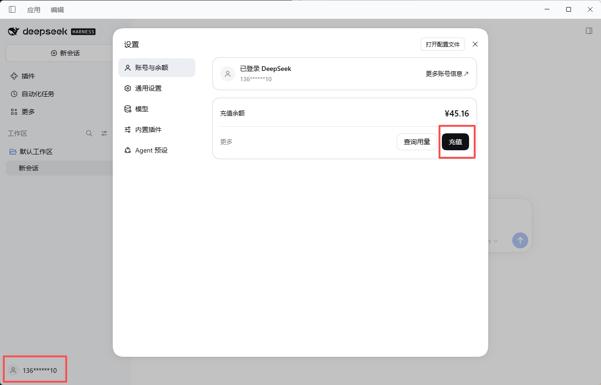

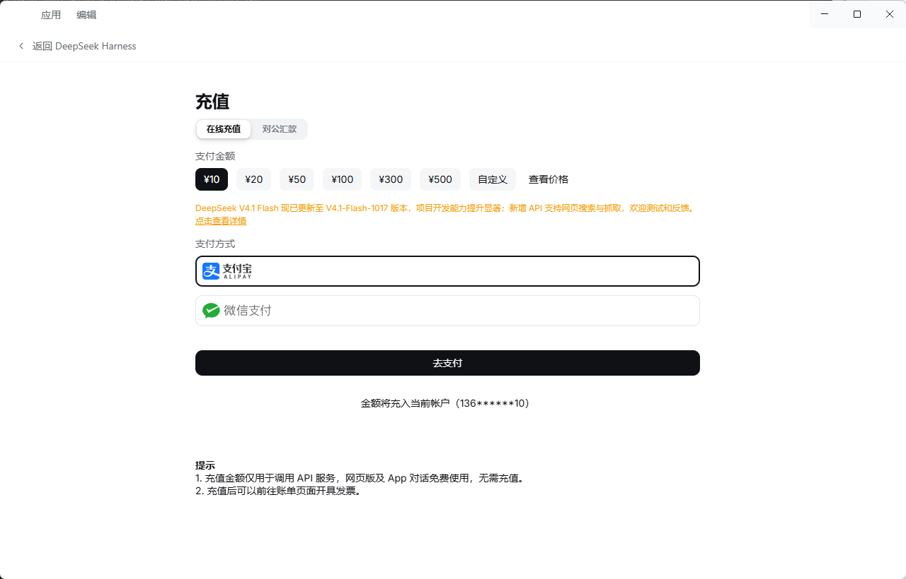

### 5.2 在网页里充值

1. 浏览器打开 `platform.deepseek.com`，确认已登录（就是第 4 步注册的那个账号）。
2. 左侧菜单点 **充值**（有的界面叫“充值中心”“账户余额”）。
3. 选金额。**第一次充 10 元就够试很久**；只想试试手，充 1 元也行。
4. 支付方式选 **支付宝** 或 **微信支付**。
5. 弹出二维码 → 用手机上的支付宝/微信 **扫一扫** → 确认付款。
6. 付完回网页看余额，没变就按 `⌘R` 刷新。
7. 回到 DeepSeek Harness，**设置 → 账号与余额** 里的 **充值余额** 数字变了就成功；还是旧的就退出客户端重新打开。

### 关于花费

- 分 **空闲时段** 和 **高峰时段** 两档价，**高峰单价是空闲的 2 倍**。具体数字见下面的价格表。
- 用多少扣多少，不用不扣；余额快没了会提示。
- 怕花超：小额充、用完再充，最稳。

### 看花了多少钱：用量信息页

客户端「设置 → 账号与余额」→ **查询用量**，会打开开放平台的 `platform.deepseek.com/usage` **用量信息** 页：

- 最上面两块数字：**充值余额**（旁边有「去充值」）和 **累计消费金额**；余额预警可以点「去设置」开。
- 下面按 **时间维度**（今天 / 本月 …）和 **API Key** 筛选，看 **消费金额**、**API 请求次数**、**Tokens** 三个汇总，以及下面的柱状图；右上角可以 **导出**。
- 按模型分组的图能看出是 flash 还是 v4-pro 花得多。

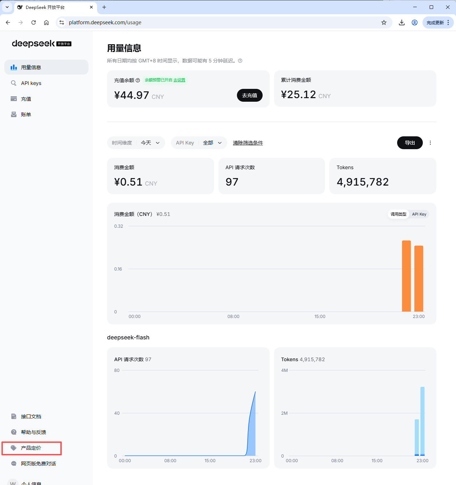

### 看单价：模型 & 价格

用量信息页左下角点 **产品定价**，会打开 API 文档的「模型 & 价格」页。表里按**“百万 tokens”**为单位列单价，每个模型下面分 **空闲时段** / **高峰时段** 两行（截图 16 红框）。以“百万 tokens 输入（缓存命中）”为例：

| 模型 | 空闲时段 | 高峰时段 |
| --- | --- | --- |
| deepseek-flash | 0.02 元 | 0.04 元 |
| deepseek-v4-pro | 0.15 元 | 0.30 元 |

同一个表里还列了各模型的版本、上下文长度、功能和**输出单价**。数字会随版本调整，**以页面上的为准**。

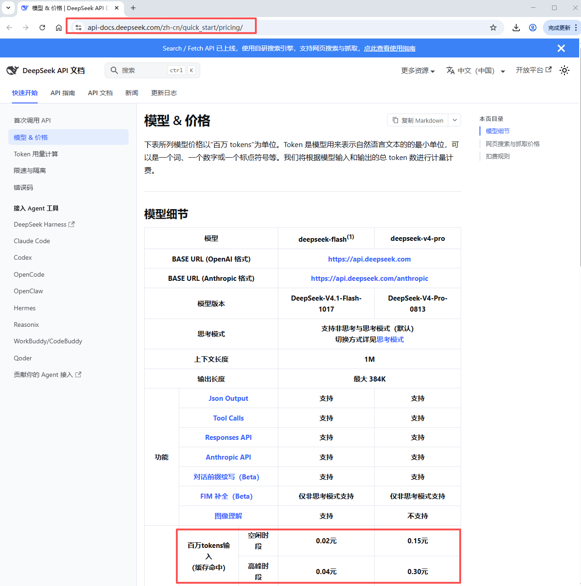

> **⚠️ 充了钱余额还是 0？**
> ① 先按 `⌘R` 刷新 / 重新打开设置窗口；② 确认充的是**开放平台账号**（和客户端里显示的手机号一致），不是聊天 App 的账号；③ 支付宝 / 微信显示付款成功但页面没更新，等一两分钟再看，不要重复付款。

---

## 6 · 第一次使用

1. 先给它指定一个**工作区**（允许它读写的文件夹）。Mac 上没有 C 盘 D 盘，路径长这样：`/Users/你的用户名/Desktop/…`。推荐做法：
   - ① 点 Dock 最左边那个笑脸（访达）→ 左侧点 **桌面**；
   - ② 按 **`⇧⌘N`** 新建文件夹，名字填 `AI 工作区`（也可以右键 → 新建文件夹；改名选中后按 `Return`）；
   - ③ 回客户端，点输入框上方那个 **默认工作区** → **➕ 添加工作区…**，在弹出的窗口里点「桌面」→ 选中 `AI 工作区` → 右下角 **打开**；
   - ④ 左侧栏出现 `AI 工作区`、输入框上方也变成它，就成了——以后它动手只在这个文件夹里。

   **不要一上来就把整个个人文件夹或「文稿」交给它**，先用空文件夹熟悉。
2. 在输入框发一句话（Mac 截图 4），比如：“帮我在当前文件夹里新建一个 hello.txt，写一句你好。”
3. 它会直接开始干活。如果弹出**权限确认**（新建文件、运行命令时可能会问），看清它要做什么再点 **允许**；**没弹窗也是正常的**——不是没生效，说明这一步不需要额外确认。
4. 做完去文件夹看，`hello.txt` 是不是真出现了。没看到就在访达里退到上一级再点回来（访达一般会自己刷新）。

> **弹性很大，不用纠结**
> 弹了权限窗：看不懂的**先点拒绝**，或者直接问它：“你刚才那步是在干什么？”
> 没弹窗：也正常，它只在**你给它的工作区文件夹**里动手，不会跑到别处去。

> **🖱 Mac 文件管理速成（看懂路径就够用）**
> - `~` 就是 `/Users/你的用户名`，也就是访达侧边栏那个「小房子」。教程里的 `~/.dsh` = 个人文件夹里的隐藏文件夹 `.dsh`。
> - 访达左侧那几项就是几个固定文件夹：**桌面 / 文稿 / 下载**，对应 `/Users/你/Desktop`、`/Users/你/Documents`、`/Users/你/Downloads`。
> - 常用快捷键：`⇧⌘N` 新建文件夹、`⌘↑` 上一级、`⇧⌘.` 显示隐藏文件、`⌥⌘P` 显示路径栏（能一眼看到自己在哪）、选中文件按 `⌥⌘C` 复制完整路径。
> - 外接硬盘 / U 盘会出现在 `/Volumes/…`，一般**别当工作区**（拔掉就没了）。
> - 第一次选「桌面」时系统会问“是否允许访问桌面文件夹”，点**允许**，不然它读不到你给的文件。

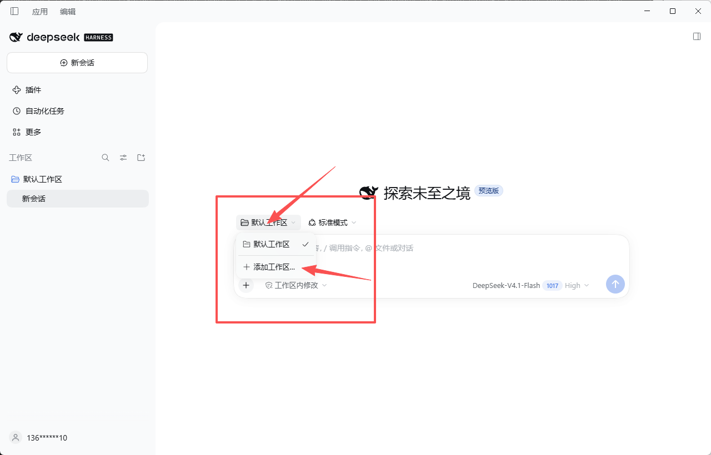


---

## 7 · 日常使用要注意的

- **点左上角红灯（或按 `⌘W`）不等于退出。** 窗口关掉了，程序还在右上角菜单栏里，任务也还在后台跑。找回窗口：点菜单栏里的图标，或者点 Dock 里的图标。
- **真正退出**：点右上角菜单栏图标 → **退出**，或者窗口在前台时按 `⌘Q`。有任务在跑会再问你一次。Dock 里图标下面那个小点没了，才算真退了。
- **自动更新**：它自己下载新版本，下次启动装好。预览版更新较频繁，属正常。
- **数据都在本机**：会话、设置存在 `~/.dsh`（`~` 就是你的个人文件夹；访达里按 `⇧⌘G` 输入 `~/.dsh` 能直接跳过去），别随手删。
- **别把密钥、密码、身份证照片发给它**，也别让它动你不了解的文件夹。
- 中文输入法打不出字：点一下输入框再试；不行就重启客户端。如果只是候选框跑到屏幕角落，把客户端窗口拖一下再点回输入框通常就好了。
- **Mac 上多一层权限**：如果它要读你桌面 / 文稿里的文件而没反应，去 **系统设置 → 隐私与安全性 → 文件和文件夹**，确认 DeepSeek Harness 是打开的。

---

## 8 · 卸载

> **🚫 顺序错了会留残余**
> 一定要先做第 2 步（在应用里移除 dsh 命令），再去系统里卸载。只把应用拖进废纸篓的话，命令行里会永久残留一个失效的 `dsh`。

### 8.1 正确顺序

1. 打开 DeepSeek Harness（还没开就先开一下），让窗口在前台。
2. 看屏幕**最上面那条菜单栏**（Mac 的程序菜单永远在屏幕顶部，不在窗口里），点 **DeepSeek Harness** → 找 **管理 dsh 命令…**（一般在“检查更新…”下面）→ 点 **移除**。
3. 按 `⌘Q` 退出（或点右上角菜单栏图标 → 退出），确认 Dock 里图标下面那个小点没了。
4. 打开「访达」→ 左侧点 **应用程序** → 找到 **DeepSeek Harness**。
5. 右键（或按住 `Control` 点）→ **移到废纸篓**，需要时输入开机密码。
6. 右键 Dock 里的废纸篓 → **清倒废纸篓**，然后再看一眼「应用程序」确认已经没了。

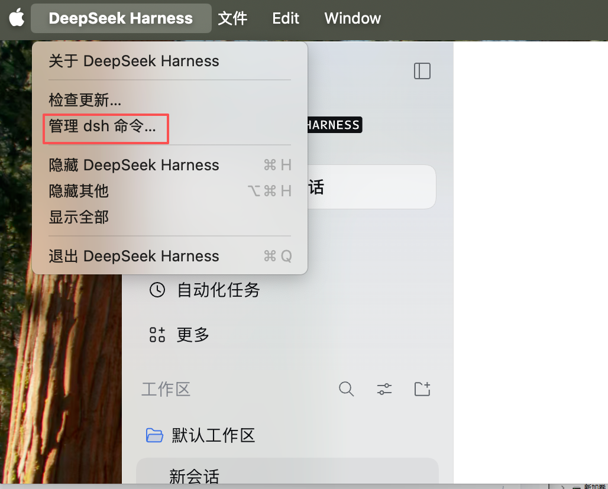

### 8.2 想彻底清干净（换账号或重装时用）

要删的只有两个地方：应用本体（已经在 8.1 删了）和数据文件夹 `.dsh`，里面是会话记录、设置和登录凭据。**删了要重新登录、重新配置；你在工作区里生成的文件不受影响。**

```text
~/.dsh
```

1. 打开「访达」，按 `⇧⌘G`（前往文件夹），输入 `~/.dsh` 回车。
2. 想用鼠标找：先在访达里按 `⌘ + ⇧ + .`（句号）显示隐藏文件，再进个人文件夹（侧边栏那个小房子图标），就能看到 `.dsh`。
3. 把它拖进废纸篓 → 右键 Dock 里的废纸篓 → **清倒废纸篓**。

> **小贴士：怎么退到上一级、怎么选中要删的文件夹**
> 按 `⇧⌘G` 跳进去后，窗口里显示的是 `.dsh` **里面的东西**，这时选不到文件夹本身。按 **`⌘ ↑`** 退回上一级（`⌥⌘↑` 是新窗口打开上一级，`⌥⌘P` 打开路径栏可以直接点上级）；退到个人文件夹后 `.dsh` 是隐藏的，按 **`⌘⇧.`** 让它显出来，点选后按 **`⌘⌫`** 移到废纸篓。

提示“正在使用”：按 `⌥⌘Esc` 打开强制退出窗口 → 选中 DeepSeek 相关项 → **强制退出**，再删。

> **想连系统缓存一起清（可选，一般用不到）**
> 访达里按 `⇧⌘G` 分别打开 `~/Library/Application Support`、`~/Library/Caches`、`~/Library/Preferences`，把名字里带 `DeepSeek` / `dsh` 的项删掉。**只删对得上那几个，别把整个 Library 删了。**

> **没有这个文件夹？**
> 说明还没生成过数据，或者早就删了，**跳过这一步即可**。

### 8.3 命令行版是另一套东西

（**用不到可以跳过**——没额外装过命令行版的话，这一段跟你无关，不影响卸载。）

先分清两个 `dsh`：**桌面版装的**那个就是 8.1 第 2 步「管理 dsh 命令…」管的，在应用里「移除」最干净；**npm 装的命令行版**是另一个包，卸载桌面版不会带走它。

查它还在不在、装在哪（`⌘ + 空格` 搜“终端”打开）：

```bash
which -a dsh
```

Mac 上常见位置：`/opt/homebrew/bin/dsh`（Apple 芯片 + Homebrew）、`/usr/local/bin/dsh`（Intel 机器，或用官方 pkg 装的）、`~/.npm-global/bin/dsh`（自己设过 npm 全局目录）。**如果打出来的是 `/Applications/DeepSeek Harness.app/…` 这种**，那就是桌面版放进去的，回 8.1 第 2 步用「移除」，不要手动 `rm`。完全没输出（not found）就说明本来就干净，跳过。

要硬删就照抄 `which dsh` 打出来的完整路径（Homebrew 目录一般归你自己所有，不加 `sudo` 也能删；`/usr/bin` 里的别碰，动了也删不掉）：

```bash
sudo rm /opt/homebrew/bin/dsh
```

如果是用 npm 装的，在「终端」里跑——**装过哪个就卸哪个，两个都各跑一次**（没装的那个会提示找不到，忽略即可）：

```bash
npm uninstall -g @deepseek-ai/dsh
npm uninstall -g deepseek-harness-cli
```

删完重开一个终端窗口（或运行 `hash -r`），再 `which dsh` 确认已经 not found。

---

## 9 · 常见问题

**Q：双击 dmg / 双击图标没反应，或者一闪而过**
A：多半是系统拦的。去 **系统设置 → 隐私与安全性** 点「仍要打开」；或者在「应用程序」里按住 `Control` 点图标 → 「打开」。还不行就是芯片选错了包，重新下对应架构的。

**Q：提示“无法打开，因为 Apple 无法验证”**
A：正常，第一次都会拦。去 **系统设置 → 隐私与安全性** → 往下滚找到“仍要打开”点一下，输密码或 Touch ID，之后就不会再问了。

**Q：系统设置里根本没有「仍要打开」这个按钮**
A：得先被拦一次，这一行才会出现在 **系统设置 → 隐私与安全性** 下方。先到「访达 → 应用程序」双击一次，弹出拦截提示时点 **好 / 完成**，再回到设置里看。或者直接用鼠标：在「应用程序」里按住 `Control` 点图标 → **打开** → 再点弹窗里的 **打开**。

**Q：提示“这台 Mac 不支持这个应用”/“不支持此架构”**
A：包下错了。Apple 芯片（M 系）要用 **arm64 / Apple Silicon** 包，Intel 机器才是 **x64**。回去看第 1 节怎么查芯片（苹果菜单 → 关于本机 → “芯片”），重下对应那个。

**Q：提示“已损坏，无法打开，你应该将它移到废纸篓”**
A：这是 macOS 对未经公证的下载包的限制，**不是真的文件坏了**。确认包是从官网下的之后，打开「终端」运行：

```bash
xattr -dr com.apple.quarantine "/Applications/DeepSeek Harness.app"
```

再双击打开。（会把整个应用从“网上下载”的标记去掉，路径按你实际的位置改。）

**Q：点「管理 dsh 命令」提示要先把它装到「应用程序」文件夹**
A：`dsh` 命令的管理只对 `/Applications` 里那份生效。先 `⌘Q` 退出 → 弹出 dmg → 只从「访达 → 应用程序」双击启动（别从 dmg 窗口或「下载」里点）。如果已经在应用程序里还报，终端运行 `xattr -dr com.apple.quarantine "/Applications/DeepSeek Harness.app"` 后重启应用，再不行重启 Mac。

**Q：登录了还是提示余额不足（报 402 之类）**
A：两种可能：① 没充值；② 登录的是聊天账号，不是开放平台账号。在客户端点左下角账号 → **设置 → 账号与余额** 看「充值余额」，确实是 0 就点旁边的 **充值**（第 5 节）；也可以去 <https://platform.deepseek.com/> 核对。

**Q：网页登录完没跳回客户端**
A：浏览器拦了跳转。回浏览器完成页点 **打开客户端**；或者直接切回客户端窗口就行。Mac 上浏览器可能先弹一句“是否允许此网页打开 DeepSeek Harness”，点 **允许**。

**Q：找不到客户端窗口**
A：窗口关了但程序还在。点屏幕**右上角菜单栏**里的图标，或者点 Dock 里的图标（点 Dock 图标没反应就按住几秒看菜单）。

**Q：删不掉应用 / 提示程序正在运行**
A：先按 `⌘Q` 真退出；还不行就按 `⌥⌘Esc` 打开强制退出窗口，选中 DeepSeek 相关项 → **强制退出**，再拖到废纸篓。

**Q：已经卸载了，命令行里的 dsh 还残留 / 报错**
A：说明卸载时跳过了「管理 dsh 命令 → 移除」。在「终端」里运行 `which -a dsh`，它会列出所有残留路径：`/opt/homebrew/bin/dsh`（Apple 芯片 + Homebrew）、`/usr/local/bin/dsh`（Intel 机器或官方 pkg）、或 npm 全局目录 `$(npm prefix -g)/bin/dsh`。照抄那个路径用 `rm` 删掉（自己的目录不用 `sudo`，`/usr/bin` 里的别碰），**别把整个 bin 目录删了**。删完 `hash -r` 或重开终端，再 `which dsh` 确认 not found。

**Q：它读不到我桌面的文件**
A：macOS 的权限限制。去 **系统设置 → 隐私与安全性 → 文件和文件夹**，确认 DeepSeek Harness 对应的开关是打开的；或者干脆把工作区选在它已经有权访问的位置（比如自己新建的文件夹）。

**Q：卡住不动 / 一直转圈**
A：网络或服务端问题。退出客户端重开；还不行就重启电脑再试。

**Q：更新之后打不开了**
A：预览版偶发问题。去官网重新下载最新安装包：把旧的应用拖到废纸篓，再把新包拖进「应用程序」就行；数据在 `~/.dsh`，不会丢。

**Q：它会不会把我的文件删掉 / 传走？**
A：它只能操作你给它指定的工作区文件夹，跑不出这个范围。新建、修改、跑命令这类动作通常先问你（有的设置下不弹，就直接做了），所以**工作区选小一点**就是最实在的保护：别一上来就把整个个人文件夹交给它。看不懂的动作先点拒绝。重要文件先备份，是永远的保险。

---

## 10 · 一页速查

| 我要做什么 | 去哪里 |
| --- | --- |
| 下载安装包 | <https://www.deepseek.com/download/> |
| 看功能介绍 | <https://www.deepseek.com/harness/> |
| 充值 | 客户端左下角账号 → 设置 → 账号与余额 → 「充值」；或 <https://platform.deepseek.com/> |
| 注册 / 看余额 / 查用量 | 客户端「设置 → 账号与余额」，或 <https://platform.deepseek.com/> |
| 看花了多少钱 | 客户端「设置 → 账号与余额」→「查询用量」，或 <https://platform.deepseek.com/usage> |
| 看单价 | 用量信息页左下角「产品定价」→ 模型 & 价格（空闲 / 高峰） |
| 找回被藏起来的窗口 | 点右上角菜单栏里的图标，或点 Dock 图标 |
| 彻底退出 | `⌘Q`，或菜单栏图标 → 退出 |
| 卸载 | 先「管理 dsh 命令 → 移除」，再把应用拖进废纸篓 |
| 数据在哪 | `~/.dsh`（隐藏文件夹，`⇧⌘G` 直达，删前先看 8.2） |

---

本教程按 DeepSeek Harness 0.2.1-rc.3 编写 · 预览版界面可能随版本调整，按钮文字以实际为准
