# DeepSeek Harness 桌面版 安装与使用教程

跟着一步一步点就行，不需要懂电脑。

- **适用系统**：Windows 10 / 11（64 位）
- **软件版本**：0.2.1-rc.3
- **全程耗时**：约 15 分钟
- **文档更新**：2026-10-28

> 图片都在 `img/` 文件夹里，文件名前缀就是正文中「截图 NN」的编号，例如 `img/13-客户端充值入口.png`。把 Markdown 和 `img/` 放在同一目录，图片就会正常显示。

## 目录

- 0 · 先搞清楚四件事
- 1 · 安装前的准备
- 2 · 下载
- 3 · 安装
- 4 · 注册账户（4.1 手机号登录 / 4.2 API Key / 4.3 稍后配置 / 4.4 设置引导）
- 5 · 充值（5.1 在客户端里 / 5.2 在网页里 / 花费与用量）
- 6 · 第一次使用
- 7 · 日常使用要注意的
- 8 · 卸载（8.1 正确顺序 / 8.2 彻底清干净 / 8.3 命令行版）
- 9 · 常见问题
- 10 · 一页速查

---

## 0 · 先搞清楚四件事

### ① 它是干什么的

DeepSeek Harness 是 DeepSeek 官方出的电脑客户端。它不只是聊天，还能读你电脑上的文件、整理资料、改代码、执行命令——是一个“能动手干活”的助手。

### ② 三个词的关系，打个比方就懂

**Agent 是机床，模型是师傅，Token 是工资。**

- **机床 = Agent**，就是你要装的这个客户端。它提供工具并真正动手：读文件、写文件、跑命令、装环境。它自己不聪明，离开师傅就是一堆铁。
- **师傅 = 模型**，DeepSeek 的大模型。它负责动脑子：听懂你的话、决定下一步干什么、把代码写出来。它在云端跑，不在你这台电脑里。
- **工资 = Token**。模型每读一个字、每写一个字都算 Token，按量计费。工资（账户余额）决定你能请谁（用哪个模型）、能干多少活（能聊多少轮）。

机床越好，能干的活越杂；师傅越强，活干得越漂亮；工资决定这两样你能用多久。**所以你只需要装机床、给工资卡充钱——师傅在云上，不用装，也装不了。**

### ③ 它要花钱，不是免费的

平常在手机 App 或网页里跟 DeepSeek 聊天是免费的，但 Harness 走的是“API 按量计费”：用多少算多少，从账户余额里扣。**余额为 0 时不能用，必须先充值。**（新用户有时送几元赠金，有没有、多久过期，以页面显示为准。）

### ④ 只从官网下载

官方入口只有这两个，别的地方下的都可能是改装版：

- <https://www.deepseek.com/download/>
- <https://www.deepseek.com/harness/>

网盘、软件下载站、所谓“绿色版 / 汉化版”，常被塞广告甚至木马，别用。

> **太长不看版**
> 官网下载 → 双击装 → 打开后点「登录」→ 手机号注册 → 点左下角账号 → **设置 → 账号与余额 → 充值** 充 10 元 → 回客户端选个文件夹 → 发一句话试试。

<details>
<summary>想多认几个名字？（不看也不影响往下做）</summary>

**叫 Agent 的（机床）**：DeepSeek Harness、Pi、Claude Code、Cursor、GitHub Copilot、Codex CLI、Windsurf、Cline、Roo Code、OpenHands；国内的还有通义灵码、Trae、CodeBuddy、Qoder……

**叫模型的（师傅）**：DeepSeek、GPT、Claude、Gemini、Grok；国内的 Qwen（通义千问）、Kimi、GLM（智谱）、豆包……

型号名字几个月换一批，记住这些“家族名”就够了。真想知道谁强，别信排行榜，拿你自己的活让它们各干一遍最准。

还有一点容易混：上面那些 Agent 里，很多是编辑器 / IDE 插件（Cursor、Copilot 这类），DeepSeek Harness 是单独的桌面程序——不写代码也能用。

</details>

---

## 1 · 安装前的准备

1. 确认系统是 64 位 Windows 10 或更高：按 `Win + Pause`，看“系统类型”那行写着“64 位操作系统”就对了。
2. 腾出大约 2 GB 硬盘空间。
3. 电脑连着网。
4. 手机放手边——注册要收短信验证码，或者用微信扫码。

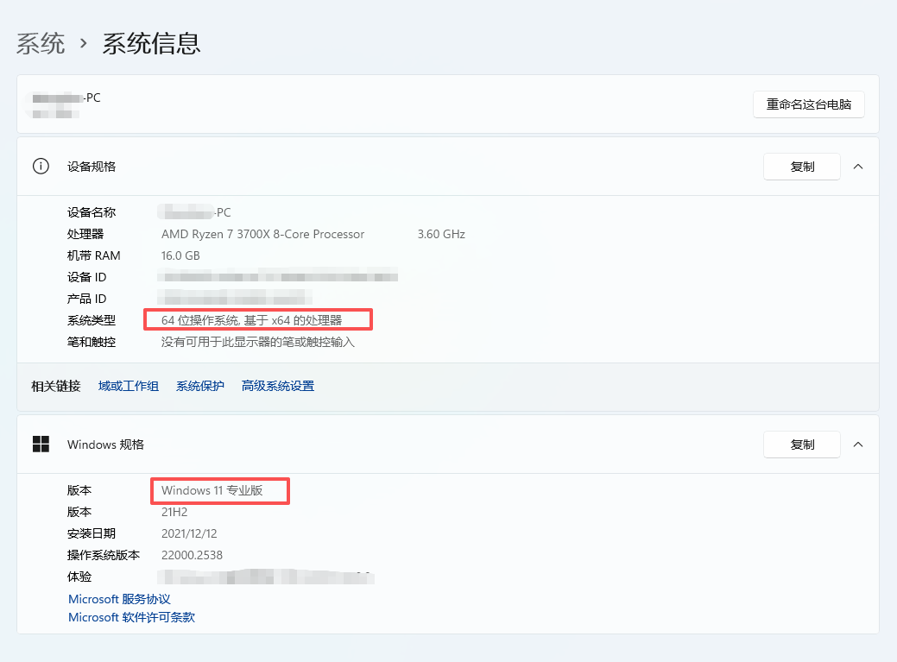

---

## 2 · 下载

1. 打开浏览器（Edge 或 Chrome 都行），地址栏输入 `www.deepseek.com/download/` 回车。
2. 往下找 **DeepSeek Harness** 那一块，点 **下载适用于 Windows 版本**（按钮上会写 Windows / x64）。
3. 浏览器开始下载一个 `.exe` 文件，名字类似 `deepseek-harness-0.2.1-rc.3-win-x64.exe`，大约 300 MB。
4. 下载完按 `Ctrl + J` 能看到它，点旁边的“在文件夹中显示”。

> **文件名里有 rc 是正常的**
> 表示“预览版”，功能正常，只是还在持续改进，会自动升级。

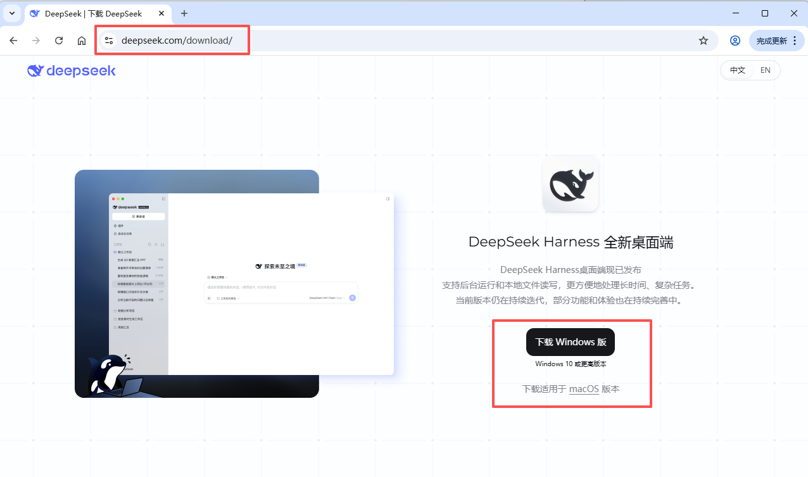

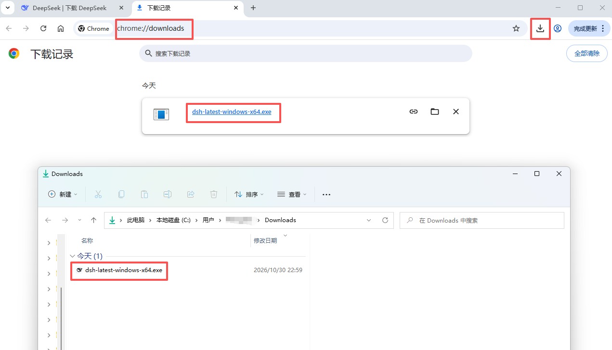

---

## 3 · 安装

1. **双击**下载好的 exe 文件。
2. **可能**会弹一个蓝色窗口 **“Windows 已保护你的电脑”**：那就点小字 **更多信息** → 再点 **仍要运行**。（官网下的可以放心点。）**没弹这个窗口也是正常的**——说明系统没拦，直接看下一步，不用找。
3. 安装程序打开后：问“为谁安装”就选 **仅为我安装**；安装路径保持默认别改；点 **安装 / Install**。
4. 进度条走完 → 点 **完成** / **运行 DeepSeek Harness**。
5. 桌面上会出现图标，右下角托盘（时间旁边的小箭头里）也会有它的图标。

> **双击后没反应？**
> 右键那个 exe → **以管理员身份运行**，再试一次。

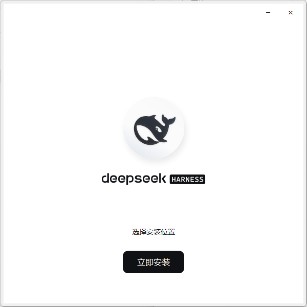

---

## 4 · 注册账户

第一次打开会出现一个**欢迎页**，上面两个入口：**登录** 和 **添加 API Key**。

> **新手直接选「登录」**
> 不用管什么是 API Key，走下面 4.1 就行。4.2 是给已经会玩 API 的人看的备选。

### 4.1 主路径：手机号注册并登录（推荐）

1. 欢迎页点 **登录**。
2. 电脑会自动打开浏览器，进入 DeepSeek 开放平台的授权页面。
3. 没注册过就点 **注册**：
   - 输入**手机号** → 点 **获取验证码**；
   - 手机收到 4~6 位数字短信，填进去；
   - 设置密码（8 位以上，字母 + 数字）；
   - 勾选同意用户协议 → 点 **注册 / 登录**。
   - 也可以选页面上的 **微信扫码**，更省事。
4. 登录成功后浏览器会显示“授权成功 / 可以返回应用”，并可能自动跳回客户端。
5. 没自动跳回来：回到浏览器那个完成页点 **打开客户端**；或者直接切回 DeepSeek Harness 窗口。
6. 回到客户端后，会先走一遍**设置引导**（见 4.4），走完就进主界面了。**设置 → 账号与余额** 里能看到余额。

> **一个特别容易误解的地方**
> 这里的账号是 **DeepSeek 开放平台（platform.deepseek.com）** 的账号，不是你手机 App 里聊天用的那个。用同一个手机号登录，但**钱包不通用**，**手机 App 里的聊天记录也不会同步过来**——这是正常的，不是出错。

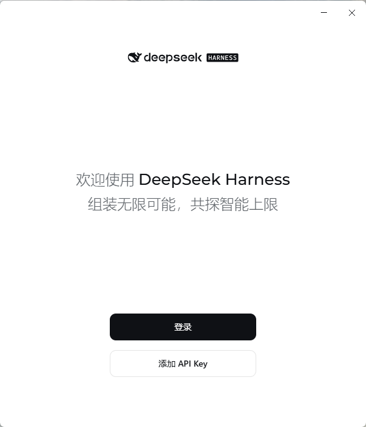

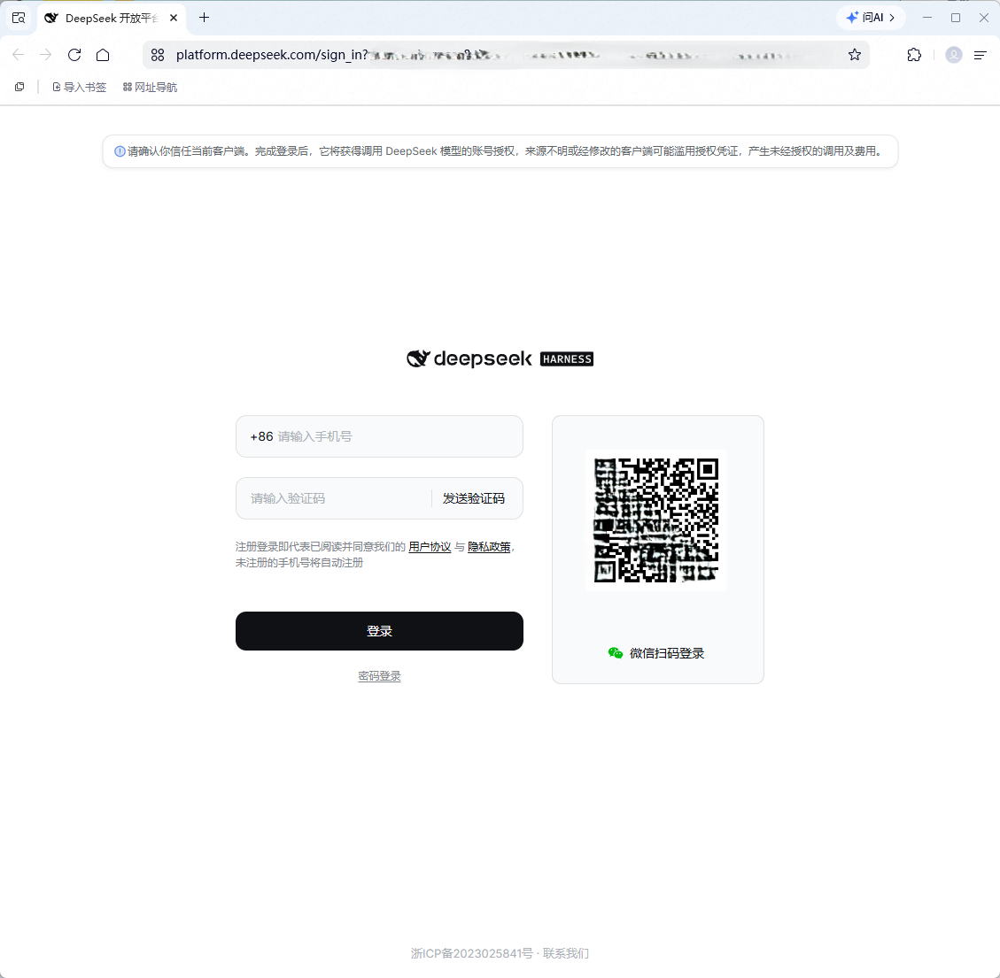

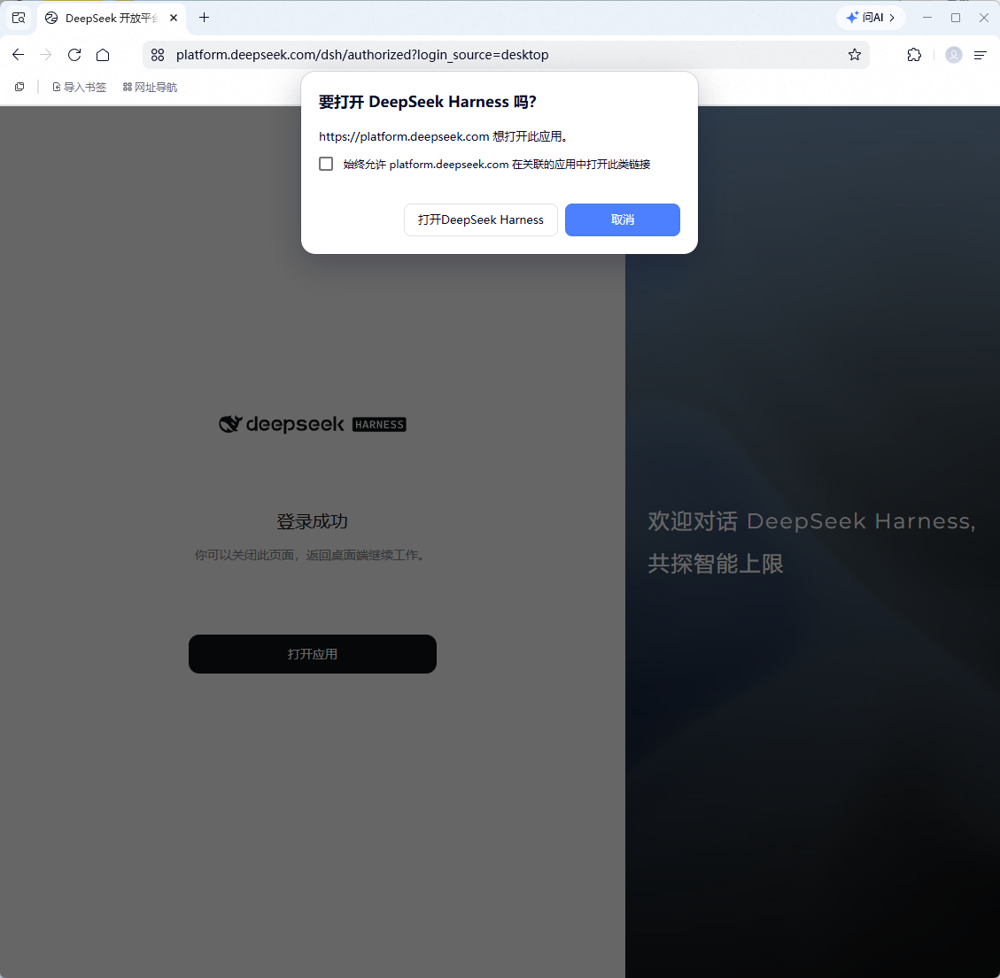

### 4.2 附注：想用 API Key 的看这里

适用情况：你已经在用 DeepSeek API，或者手上有别人给的密钥。

1. 浏览器打开 `platform.deepseek.com`，用手机号登录。
2. 左侧菜单点 **API Keys** → **创建 API Key** → 起个名（比如 `my-pc`）→ 创建。
3. 页面显示一串以 `sk-` 开头的字符。**它只显示这一次**，点“复制”立刻存到记事本里。
4. 回到客户端欢迎页点 **添加 API Key**，粘贴进去 → **保存并继续**。

> **🚫 密钥就等于银行卡密码**
> 别发群里、别贴到网上、别让它出现在截图里。泄露了别人就能花你的钱。

### 4.3 暂时不想登录

欢迎页上有 **稍后配置**，可以先看看界面。但只要有任务要调用模型，就必须先配好账号或密钥，否则会报错。

### 4.4 第一次进客户端：跟着设置引导走一遍

授权成功、第一次进客户端时，会自动出现一个**设置引导**，一共五屏，一屏点一次 **下一步 / 继续**，走完就进主界面了。

1. 前面几屏是说明和基本设置，看着点「下一步」就行。
2. 如果某一屏让你选**工作区文件夹**，先选个空文件夹——比如在桌面上新建一个 `AI 工作区`。**别一上来就选整个 C 盘或“文档”**（第 6 节细讲）。
3. 有一屏上就有 **充值** 按钮（截图 10）。新账号余额是 0，**直接在这儿点进去充**，比单独去网页少走一步，详细步骤见第 5 节。
4. 有一屏需要你做一个选择（截图 11），按自己的需要选，选完点「下一步」。
5. 看到主界面（引导第 5 屏，截图 12）就说明配置完了，可以开始用。
   引导只弹这一次，以后想改设置就去 **设置** 里改，选错了不用重来。

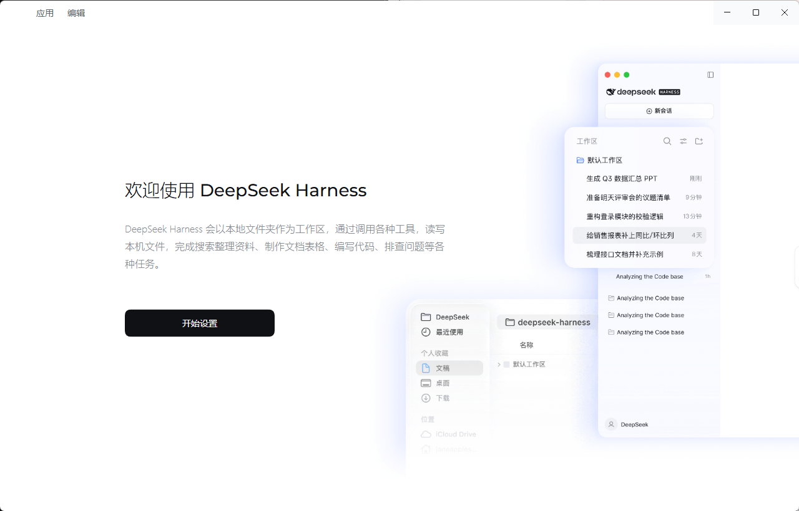

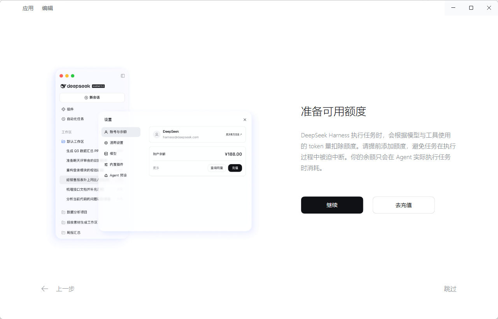

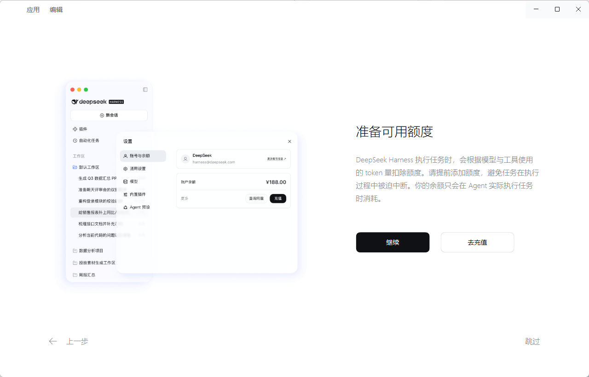

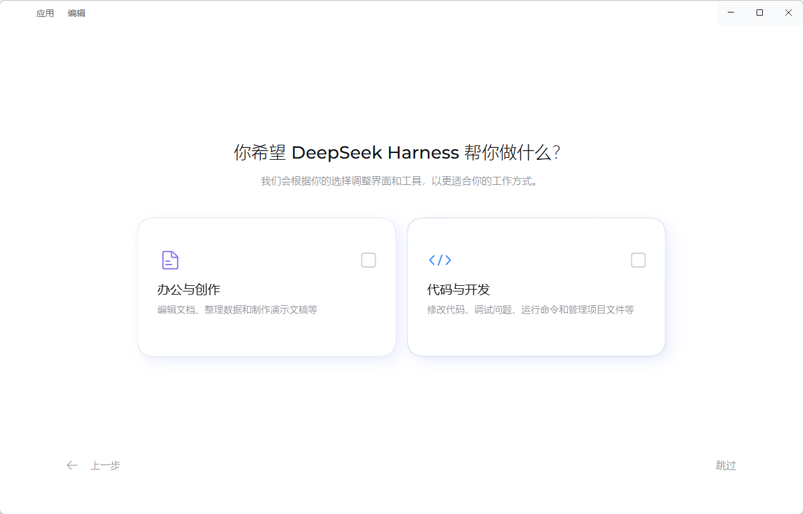

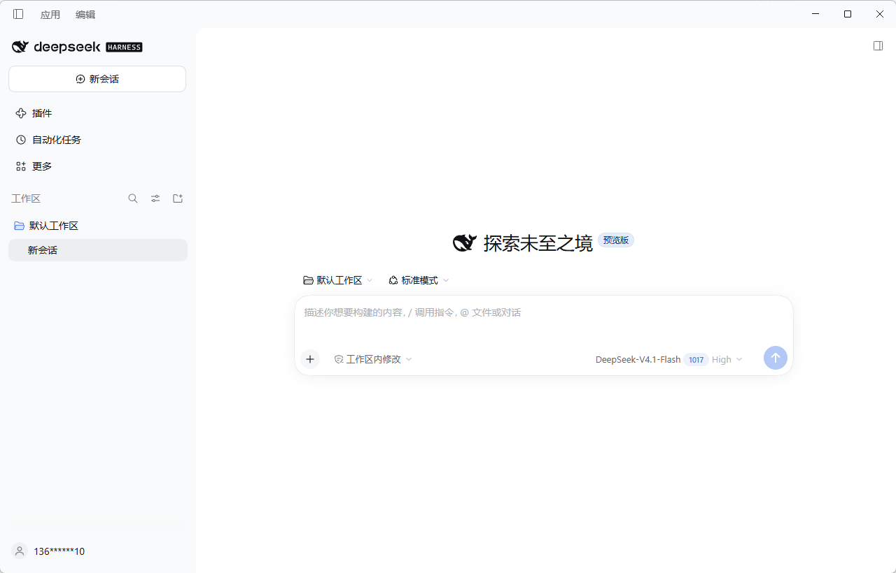

---

## 5 · 充值（关键一步）

登录后余额通常是 0，或者只有一点赠金——**这时候还干不了活，得自己充钱**。两条路效果一样：**在客户端里点**（5.1，推荐），或者**去网页充值**（5.2）。钱充进的是同一个账户，用哪个都行。

### 5.1 在客户端里充值（推荐）

1. 打开 DeepSeek Harness，点窗口**左下角**自己账号那一行（显示手机号，比如 `136******10`）。
2. 弹出**设置**窗口，左侧菜单点 **账号与余额**。
3. 右侧上方是账号卡片：**已登录 DeepSeek** + 手机号；右边有 **更多账号信息 ↗**，想看网页端的账户详情就从这儿跳。
4. 下面一张卡片写着 **充值余额** 和当前金额（新账号是 `¥0.00`）。点右下的 **充值** 按钮（截图 13 红框）。
5. 浏览器会打开开放平台的收银台，从下面 5.2 的**第 3 步**接着做（选金额 → 扫码付款）。
6. 付完切回客户端，**设置 → 账号与余额** 里的 **充值余额** 数字变了就成功了；没变就退出客户端重新打开。

> **同一张卡片上还有两个按钮**
> **查询用量** 看已经花了多少、每次任务扣了多少；**更多账号信息 ↗** 跳到网页端看账单、改绑手机、查发票。余额和用量都能在里面看清楚。

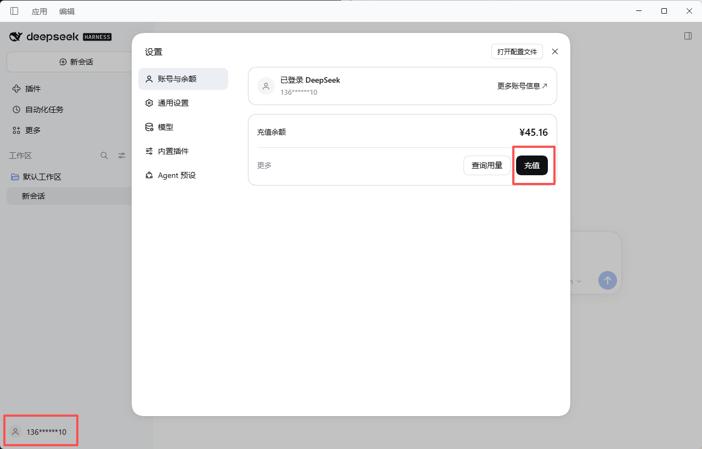

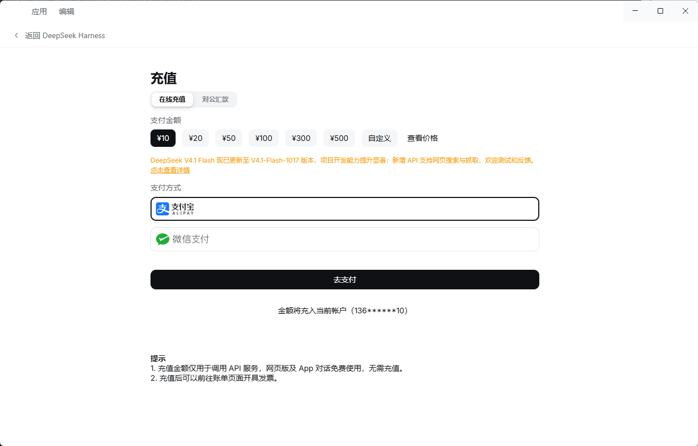

### 5.2 在网页里充值

1. 浏览器打开 `platform.deepseek.com`，确认已登录（就是第 4 步注册的那个账号）。
2. 左侧菜单点 **充值**（有的界面叫“充值中心”“账户余额”）。
3. 选金额。**第一次充 10 元就够试很久**；只想试试手，充 1 元也行。
4. 支付方式选 **支付宝** 或 **微信支付**。
5. 弹出二维码 → 用手机上的支付宝/微信 **扫一扫** → 确认付款。
6. 付完回网页看余额，没变就按 `F5` 刷新。
7. 回到 DeepSeek Harness，**设置 → 账号与余额** 里的 **充值余额** 数字变了就成功；还是旧的就退出客户端重新打开。

### 关于花费

- 分 **空闲时段** 和 **高峰时段** 两档价，**高峰单价是空闲的 2 倍**。具体数字见下面的价格表。
- 用多少扣多少，不用不扣；余额快没了会提示。
- 怕花超：小额充、用完再充，最稳。

### 看花了多少钱：用量信息页

客户端「设置 → 账号与余额」→ **查询用量**，会打开开放平台的 `platform.deepseek.com/usage` **用量信息** 页：

- 最上面两块数字：**充值余额**（旁边有「去充值」）和 **累计消费金额**；余额预警可以点「去设置」开。
- 下面按 **时间维度**（今天 / 本月 …）和 **API Key** 筛选，看 **消费金额**、**API 请求次数**、**Tokens** 三个汇总，以及下面的柱状图；右上角可以 **导出**。
- 按模型分组的图能看出是 flash 还是 v4-pro 花得多。

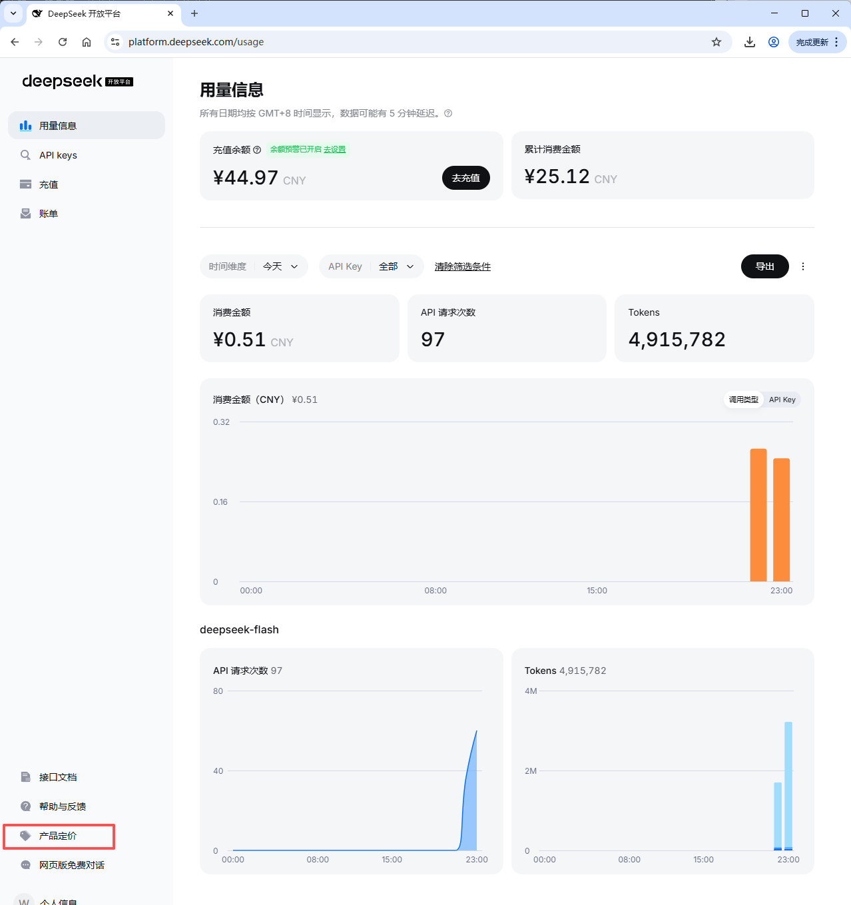

### 看单价：模型 & 价格

用量信息页左下角点 **产品定价**，会打开 API 文档的「模型 & 价格」页。表里按**“百万 tokens”**为单位列单价，每个模型下面分 **空闲时段** / **高峰时段** 两行（截图 16 红框）。以“百万 tokens 输入（缓存命中）”为例：

| 模型 | 空闲时段 | 高峰时段 |
| --- | --- | --- |
| deepseek-flash | 0.02 元 | 0.04 元 |
| deepseek-v4-pro | 0.15 元 | 0.30 元 |

同一个表里还列了各模型的版本、上下文长度、功能和**输出单价**。数字会随版本调整，**以页面上的为准**。

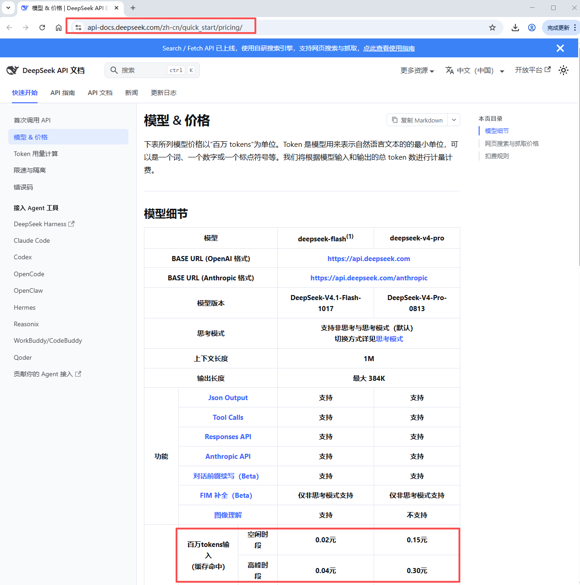

> **⚠️ 充了钱余额还是 0？**
> ① 先按 `F5` 刷新 / 重新打开设置窗口；② 确认充的是**开放平台账号**（和客户端里显示的手机号一致），不是聊天 App 的账号；③ 支付宝 / 微信显示付款成功但页面没更新，等一两分钟再看，不要重复付款。

---

## 6 · 第一次使用

1. 先给它指定一个**工作区**（允许它读写的文件夹）。点 **选择文件夹 / 添加工作区**，比如在桌面新建一个 `AI 工作区` 选它。
   **不要一上来就把整个 C 盘或“文档”交给它**，先用空文件夹熟悉。
2. 在输入框发一句话（截图 18），比如：“帮我在当前文件夹里新建一个 hello.txt，写一句你好。”
3. 它会直接开始干活。如果弹出**权限确认**（新建文件、运行命令时可能会问），看清它要做什么再点 **允许**；**没弹窗也是正常的**——不是没生效，说明这一步不需要额外确认。
4. 做完去文件夹看，`hello.txt` 是不是真出现了。没看到就按 `F5` 刷新一下文件夹。

> **弹性很大，不用纠结**
> 弹了权限窗：看不懂的**先点拒绝**，或者直接问它：“你刚才那步是在干什么？”
> 没弹窗：也正常，它只在**你给它的工作区文件夹**里动手，不会跑到别处去。

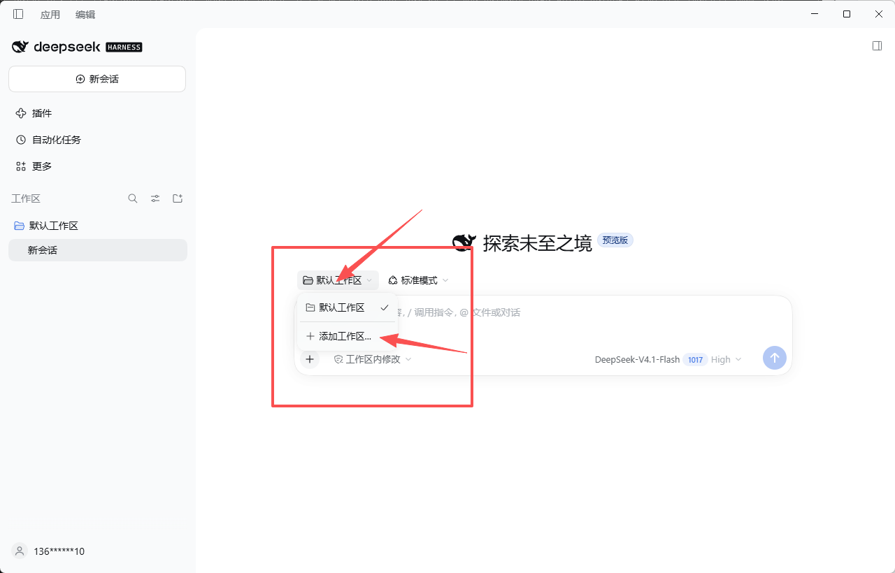

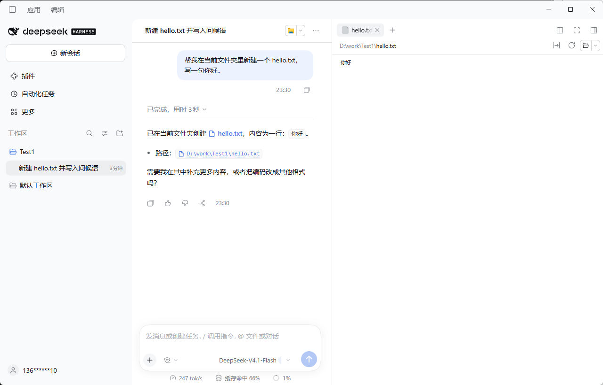

---

## 7 · 日常使用要注意的

- **点“×”不等于退出。** 关窗口只是藏到右下角托盘，任务还在后台跑。找回窗口：点一下托盘里它的图标。
- **真正退出**：右键托盘图标 → **退出**。有任务在跑会再问你一次。
- **自动更新**：它自己下载新版本，下次启动装好。预览版更新较频繁，属正常。
- **数据都在本机**：会话、设置存在 `%USERPROFILE%\.dsh`（客户端菜单里如果有「打开数据目录」之类的入口，点一下就能直接跳过去），别随手删。
- **别把密钥、密码、身份证照片发给它**，也别让它动你不了解的文件夹。
- 中文输入法打不出字：点一下输入框再试；不行就重启客户端。

---

## 8 · 卸载

> **🚫 顺序错了会留残余**
> 一定要先做第 2 步（在应用里移除 dsh 命令），再去系统里卸载。只跑卸载程序的话，命令行里会永久残留一个失效的 `dsh`。

### 8.1 正确顺序

1. 打开 DeepSeek Harness（还没开就先开一下）。
2. 菜单里找 **管理 dsh 命令…**（一般在“检查更新…”下面）→ 点 **移除**。
3. 右键托盘图标 → **退出**，确保进程真的没了。
4. 按 `Win + I` 打开设置，再走对应系统的路径：
   - Windows 11：**应用** → **已安装的应用**
   - Windows 10：**应用** → **应用和功能**
5. 搜索框输入 `DeepSeek`，找到 **DeepSeek Harness** → 点右边 **⋯** → **卸载**。
6. 卸载向导点 **卸载 / Uninstall**，等走完 → 关闭。
7. 再搜一次 `DeepSeek`，确认已经没了。

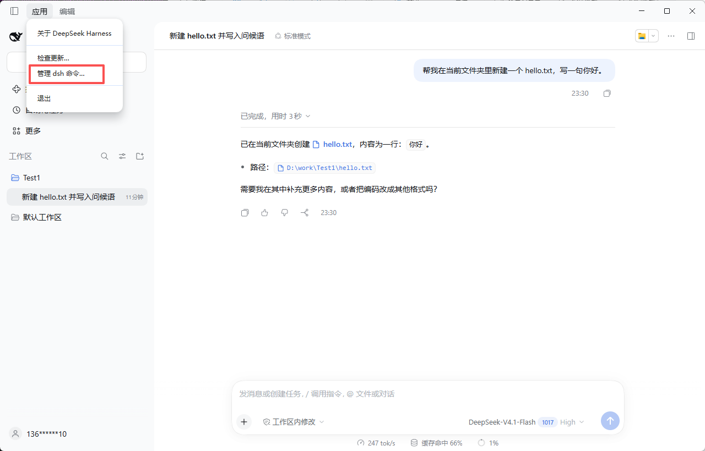

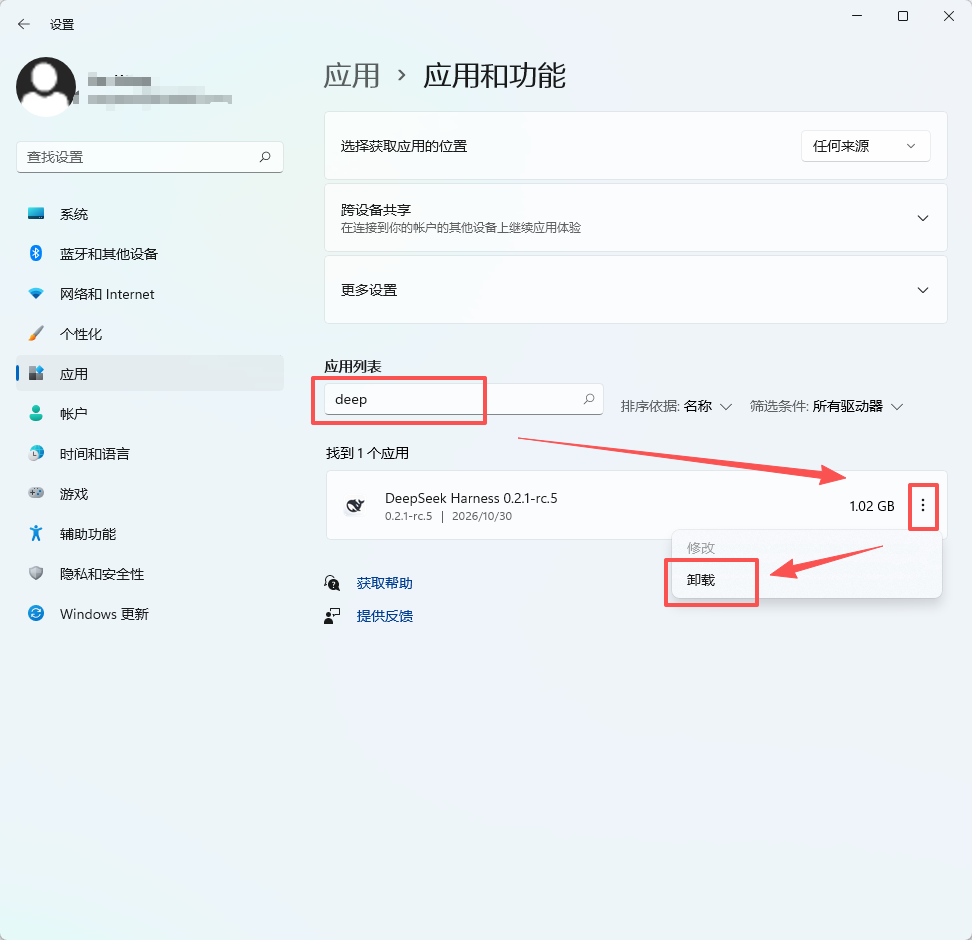

### 8.2 想彻底清干净（换账号或重装时用）

要删的只有一个文件夹 `.dsh`，里面是会话记录、设置和登录凭据。**删了要重新登录、重新配置；你在工作区里生成的文件不受影响。**

```text
%USERPROFILE%\.dsh
```

1. 按 `Win + R`，输入 `%USERPROFILE%` 回车，打开个人文件夹。
2. 点窗口上方 **查看 → 显示 → 隐藏的项目**。它是以点开头的，默认被藏起来。
3. 找到 `.dsh` 文件夹，右键 → **删除**。

提示“文件正在使用”：`Ctrl + Shift + Esc` 开任务管理器 → 结束 DeepSeek 相关进程，再删。

> **没有这个文件夹？**
> 说明还没生成过数据，或者早就删了，**跳过这一步即可**。

### 8.3 命令行版是另一套东西

（**看不懂就跳过**——你没额外装过命令行版的话，这一段跟你无关，不影响卸载。）

如果电脑上还有命令行版（`dsh` 命令），卸载桌面版不会连带删掉它。想一起清掉，在命令行运行——**装过哪个就卸哪个，两个都各跑一次**（没装的那个会提示找不到，忽略即可）：

```bash
npm uninstall -g @deepseek-ai/dsh
npm uninstall -g deepseek-harness-cli
```

---

## 9 · 常见问题

**Q：双击安装包没反应 / 一闪而过**
A：多半被安全软件拦了。右键安装包 → **以管理员身份运行**。仍不行就临时关掉杀毒软件再装，装完马上开回来。

**Q：显示“Windows 已保护你的电脑”**
A：新软件的正常提示，不是中毒。点 **更多信息** → **仍要运行**。前提是安装包从官网下的。

**Q：安装到最后报错**
A：常见原因是磁盘满或权限不足。清出 2 GB 空间，右键安装包用管理员身份运行再试。

**Q：登录了还是提示余额不足（报 402 之类）**
A：两种可能：① 没充值；② 登录的是聊天账号，不是开放平台账号。在客户端点左下角账号 → **设置 → 账号与余额** 看「充值余额」，确实是 0 就点旁边的 **充值**（第 5 节）；也可以去 <https://platform.deepseek.com/> 核对。

**Q：网页登录完没跳回客户端**
A：浏览器拦了跳转。回浏览器完成页点 **打开客户端**；或者直接切回客户端窗口就行。

**Q：找不到客户端窗口**
A：被藏到托盘了。点右下角托盘（时间旁边的小箭头）里的 DeepSeek Harness 图标。

**Q：点卸载时说程序正在运行**
A：只关了窗口，没真退出。右键托盘图标 → **退出**；再到任务管理器确认没有 DeepSeek 进程。

**Q：已经卸载了，命令行里的 dsh 还残留 / 报错**
A：说明卸载时跳过了「管理 dsh 命令 → 移除」。在命令行运行 `where dsh`，它会列出残留路径（一般在 `%LOCALAPPDATA%\Programs\` 下，或 npm 全局目录 `npm root -g` 里）。把那个 `dsh.cmd` / `dsh.exe` 删掉即可，**别把整个文件夹都删了**。如果提示“找不到命令”，说明本来就清干净了，不用管。

**Q：卡住不动 / 一直转圈**
A：网络或服务端问题。退出客户端重开；还不行就重启电脑再试。

**Q：更新之后打不开了**
A：预览版偶发问题。去官网重新下载最新安装包装一遍——会覆盖程序，你的数据还在。

**Q：它会不会把我的文件删掉 / 传走？**
A：它只能操作你给它指定的工作区文件夹，跑不出这个范围。新建、修改、跑命令这类动作通常先问你（有的设置下不弹，就直接做了），所以**工作区选小一点**就是最实在的保护：别一上来就把整个 C 盘交给它。看不懂的动作先点拒绝。重要文件先备份，是永远的保险。

---

## 10 · 一页速查

| 我要做什么 | 去哪里 |
| --- | --- |
| 下载安装包 | <https://www.deepseek.com/download/> |
| 看功能介绍 | <https://www.deepseek.com/harness/> |
| 充值 | 客户端左下角账号 → 设置 → 账号与余额 → 「充值」；或 <https://platform.deepseek.com/> |
| 注册 / 看余额 / 查用量 | 客户端「设置 → 账号与余额」，或 <https://platform.deepseek.com/> |
| 看花了多少钱 | 客户端「设置 → 账号与余额」→「查询用量」，或 <https://platform.deepseek.com/usage> |
| 看单价 | 用量信息页左下角「产品定价」→ 模型 & 价格（空闲 / 高峰） |
| 找回被藏起来的窗口 | 点右下角托盘里的图标 |
| 彻底退出 | 右键托盘图标 → 退出 |
| 卸载 | 先「管理 dsh 命令 → 移除」，再从「设置 → 应用」卸载 |
| 数据在哪 | `%USERPROFILE%\.dsh`（隐藏文件夹，删前先看 8.2） |

---

本教程按 DeepSeek Harness 0.2.1-rc.3 编写 · 预览版界面可能随版本调整，按钮文字以实际为准
